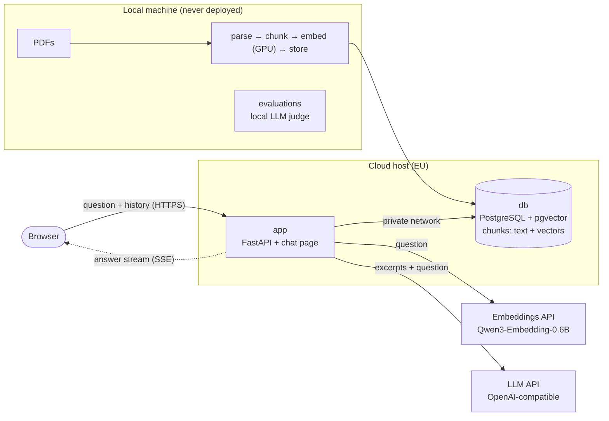

# TFM Chatbot

[](https://github.com/jmanresarigo/TFM-ChatBot/actions/workflows/ci.yml)


A retrieval-augmented generation (RAG) chat assistant that answers questions about a Master's thesis, *Spiking Neural Networks for Lift Coefficient Reconstruction in Extreme Vortex-Gust Airfoil Interactions*, and the literature it cites. Every answer is grounded in the documents and cites them in IEEE style, down to the page.

The project was built to learn the full lifecycle of an AI application: document ingestion, hybrid retrieval, evaluation, LLM integration, a streaming web app, containers, continuous integration and cloud deployment.

> [!NOTE]
> The documents themselves are **not** part of this repository: the thesis is unpublished and the cited papers are copyrighted. The code, prompts and tests are here; to run the app you supply your own PDFs (see [Adding documents](#adding-documents)).

## Table of contents

- [Features](#features)
- [How it works](#how-it-works)
- [Tech stack](#tech-stack)
- [Repository structure](#repository-structure)
- [Getting started](#getting-started)
- [Configuration](#configuration)
- [Adding documents](#adding-documents)
- [API](#api)
- [Testing and CI](#testing-and-ci)
- [Evaluation](#evaluation)
- [Deployment](#deployment)
- [Data, privacy and security](#data-privacy-and-security)
- [Known limitations](#known-limitations)
- [License](#license)
- [Author](#author)

## Features

- **Grounded answers.** The model answers only from retrieved excerpts and says so when the documents don't contain the answer.
- **IEEE citations.** Each claim carries a numbered citation. Under the answer, a collapsible reference list gives the full IEEE entry of each document, the pages used and a DOI link.
- **Hybrid search.** Semantic (vector) search and keyword (full-text) search, merged with weighted Reciprocal Rank Fusion.
- **Conversation memory.** Follow-up questions ("and its time step?") are rewritten into standalone search queries; questions about the conversation itself skip the search.
- **Streaming.** Answers appear word by word (Server-Sent Events), rendered as Markdown with LaTeX math.
- **Citation checks.** Citations to excerpts that were never retrieved are flagged in the interface.
- **Context meter.** Shows how much of the model's context window the conversation uses; the oldest messages are dropped when it is full.
- **Evaluation suite.** Retrieval metrics (hit@k, MRR) and answer quality scored by a local LLM judge.
- **Clear limit messages.** When a free-tier API limit is reached, the chat says which limit and shows a countdown until the user can ask again.
- **Stateless server.** The browser keeps the conversation; any server instance can answer any request.

## How it works



**Answering a question**

1. **Route** (follow-ups only): a short LLM call decides whether the documents are needed and rewrites the follow-up into a standalone query.
2. **Embed** the query with the same model that embedded the documents.
3. **Search** Postgres with vector search (meaning) and full-text search (exact terms), fused with weighted Reciprocal Rank Fusion (keyword list at half weight); keep the top 5 chunks.
4. **Generate** the answer from a system prompt, the recent history (trimmed to a token budget), the numbered excerpts and the question, streaming it to the browser.
5. **Check citations**: each `[n]` is mapped back to its document and pages; the browser renumbers them per document and shows the IEEE references.

**Building the knowledge base** (offline, on a local machine)

1. **Parse** each PDF page by page with PyMuPDF. The cleaning step fixes ligatures and broken accents, keeps printed page labels, and drops headers, footers, tables of contents and reference lists.
2. **Chunk** the text into ~250-word passages along paragraph and sentence boundaries, with overlap. Headings stay attached to their text.
3. **Embed** the chunks into 1024-dimensional vectors on the GPU.
4. **Store** chunks and vectors in Postgres (HNSW vector index and GIN full-text index). Each reload runs in a single transaction.

## Tech stack

| Area | Choice |
|---|---|
| Language, packaging | Python 3.12, [uv](https://docs.astral.sh/uv/) (`pyproject.toml` + `uv.lock`) |
| PDF parsing | [PyMuPDF](https://pymupdf.readthedocs.io/) with custom cleaning |
| Embeddings | [Qwen3-Embedding-0.6B](https://huggingface.co/Qwen/Qwen3-Embedding-0.6B): sentence-transformers on the GPU for ingestion; a hosted API (Cloudflare Workers AI) for questions |
| Vector database | PostgreSQL 17 + [pgvector](https://github.com/pgvector/pgvector) (HNSW), full-text search (GIN) |
| LLM | Any OpenAI-compatible API (deployed with Groq; a local Ollama also works) |
| Web | FastAPI, uvicorn, Server-Sent Events; plain HTML/CSS/JS with [marked](https://marked.js.org/), [KaTeX](https://katex.org/) and [DOMPurify](https://github.com/cure53/DOMPurify) (vendored) |
| Containers | Docker (slim image without ML libraries), Docker Compose |
| CI/CD | GitHub Actions (ruff, pytest, Docker build and start-up test); deployment from `main` after CI passes |
| Hosting | [Railway](https://railway.com/): app and database services |

## Repository structure

```
app/                         the web application (this is what gets deployed)
├── main.py                  FastAPI server: chat API (SSE), health checks, password protection
├── llm.py                   prompts, routing, history trimming, OpenAI-compatible client
├── retrieval.py             question embedding, vector + keyword search, RRF fusion
├── references.json          IEEE reference of each document, keyed by PDF file name
└── static/
    ├── index.html           chat interface
    └── vendor/              marked, DOMPurify, KaTeX (+ fonts)
ingestion/                   offline pipeline that builds the database
├── parse.py                 PDF -> clean page text
├── chunk.py                 pages -> overlapping chunks
├── embed.py                 chunks -> vectors (GPU)
└── store.py                 chunks + vectors -> Postgres
evals/
├── questions.jsonl          evaluation questions with answer keys (document + pages)
├── run_retrieval_eval.py    hit@k and MRR
├── run_answer_eval.py       deterministic checks + LLM judge
└── results/                 score summaries only (no document text)
prompts/                     versioned system, routing and judge prompts
tests/                       unit tests (made-up text and fakes; no real services)
data/                        NOT committed: PDFs and generated files (parsed/, chunks/, embeddings/)
Dockerfile                   production image
docker-compose.yml           local Postgres + app
.env.example                 template for the configuration
.github/workflows/ci.yml     continuous integration
```

## Getting started

### Prerequisites

- Python 3.12 and [uv](https://docs.astral.sh/uv/getting-started/installation/)
- Docker (Docker Desktop on Windows/macOS)
- An NVIDIA GPU is recommended for embedding the documents (CPU works, but slowly)
- API keys for an OpenAI-compatible LLM provider and an embeddings provider (both have free tiers)
- The PDFs you want to query

### 1. Install

```bash
git clone https://github.com/jmanresarigo/TFM-ChatBot.git
cd TFM-ChatBot
uv sync                      # runtime, ingestion (PyTorch) and dev dependencies
cp .env.example .env         # then fill in your own values (see Configuration)
```

### 2. Start the database

```bash
docker compose up -d db      # Postgres + pgvector, reachable only from this machine
```

### 3. Build the knowledge base

Put the PDFs in `data/` and run the pipeline once (and again whenever the documents change):

```bash
uv run python ingestion/parse.py     # optional: writes data/parsed/ for inspection
uv run python ingestion/chunk.py
uv run python ingestion/embed.py     # uses the GPU if available
uv run python ingestion/store.py
```

### 4. Run the app

```bash
uv run uvicorn main:app --app-dir app --reload --port 8080   # development
# or the production image, exactly as deployed:
docker compose up -d --build
```

Open <http://127.0.0.1:8080> and ask a question.

Command-line tools for debugging:

```bash
uv run python app/retrieval.py "What is the membrane decay factor?"   # show search results
uv run python app/llm.py --chat                                        # chat in the terminal
```

## Configuration

All settings are environment variables: a `.env` file locally (start from `.env.example`), the platform's variables in production. **Never commit `.env`.**

| Variable | Purpose |
|---|---|
| `POSTGRES_USER`, `POSTGRES_PASSWORD`, `POSTGRES_DB` | credentials of the local Docker database |
| `DATABASE_URL` | Postgres connection string used by the app and the ingestion scripts |
| `EMBEDDING_MODEL` | model whose vectors are stored; must be the same at ingestion and query time |
| `HF_HUB_OFFLINE` | `1` to load the local embedding model from cache without contacting Hugging Face |
| `EMBEDDING_BASE_URL`, `EMBEDDING_API_KEY`, `EMBEDDING_API_MODEL` | embeddings API used to embed questions |
| `LLM_BASE_URL`, `LLM_API_KEY`, `LLM_MODEL` | OpenAI-compatible LLM API |
| `LLM_REASONING_EFFORT` | reasoning effort for models that support it |
| `LLM_NUM_CTX` | token budget for prompt + history (default 8192) |
| `ROUTER_MODEL` | optional separate model for the routing step |
| `SYSTEM_PROMPT` | which prompt in `prompts/` to use (default `prompts/system_v3.md`) |
| `APP_PASSWORD` | password for the web app; empty disables it (local use only) |
| `JUDGE_MODEL`, `JUDGE_BASE_URL`, `JUDGE_PROMPT` | local LLM judge for the answer evaluation |

## Adding documents

1. Copy the PDF into `data/`. A PDF needs a text layer; scanned documents need OCR first.
2. Add its reference to `app/references.json`, keyed by the file name. `*text*` is rendered in italics:
   ```json
   "Example2024_Paper.pdf": {
     "text": "A. Author and B. Author, “Title of the paper,” *Journal Name*, vol. 1, no. 2, pp. 3–4, 2024.",
     "url": "https://doi.org/10.xxxx/xxxxx"
   }
   ```
   Documents without an entry are cited by their file name.
3. Rebuild the knowledge base with `chunk.py`, `embed.py` and `store.py`. `store.py` replaces each document's chunks and removes documents that are no longer in `data/`.
4. Re-run the retrieval evaluation to check that search quality hasn't dropped.

## API

| Method and path | Description |
|---|---|
| `GET /` | chat interface |
| `POST /api/chat` | body `{"question": str, "history": [{"role", "content"}]}`; responds with Server-Sent Events: `route`, `excerpts`, `token`, `done` or `error` |
| `GET /health` | readiness: checks the database, the embeddings API and the LLM API; returns 200 or 503 |
| `GET /health/live` | liveness: returns 200 as soon as the server is running |
| `GET /static/...` | the interface's scripts, styles and fonts |

When `APP_PASSWORD` is set, every path except the two health checks requires it (HTTP Basic authentication).

### When a free-tier limit is reached

The app has no usage limits of its own: it is a private demo with very little traffic. Its two APIs have free-tier limits, though: tokens and requests per minute and per day for the LLM, and a daily allowance for the embeddings. When one is reached, the chat shows a notice instead of an answer, with a live countdown until the user can ask again. The notice says which limit was hit (for example "tokens per minute") and how long to wait.

The wait comes from the provider's response: Groq states it in its error message ("Please try again in 1m14.5s"), and the `Retry-After` header is the fallback. The provider's raw error text, which includes the account's organization ID, is written only to the server log. Short per-minute waits (up to 20 s) are retried automatically before the user sees anything.

## Testing and CI

```bash
uv run ruff check .          # lint
uv run pytest                # unit tests
```

The tests use made-up text and fake services, so they need no documents, database or API keys. GitHub Actions runs the same checks on every pull request and on every push to `main`. It then builds the Docker image and checks that the container starts.

```
pull request   ──► CI: ruff · pytest · Docker build + start-up test
merge to main  ──► CI on main ──► deployment waits for CI ──► build ──► /health/live ──► switch traffic
```

## Evaluation

The evaluation set has **64 questions** covering all 33 documents of the corpus: 57 answerable (38 factual, 14 paraphrased, 5 terminology, one of them in Spanish) and 7 deliberately unanswerable. Each answerable question records the document and pages that contain the answer, plus other documents that also answer it where relevant. Only 14 questions are about the thesis itself, so the scores reflect the whole literature, not just one document. The evaluations need the documents, so they are run by hand:

```bash
uv run python evals/run_retrieval_eval.py --mode all   # retrieval: hit@k, MRR
uv run python evals/run_answer_eval.py generate        # answers via the LLM API
uv run python evals/run_answer_eval.py judge           # scoring by a local LLM judge
```

**Retrieval** (57 answerable questions, top 5 chunks, 33 documents / 2,279 chunks). A question counts as a hit at rank *r* when the *r*-th chunk comes from an expected document and page:

| Mode | hit@1 | hit@3 | hit@5 | MRR |
|---|---|---|---|---|
| **hybrid, weighted RRF (used by the app)** | **53%** | **84%** | **91%** | **0.68** |
| hybrid, equal-weight RRF (before tuning) | 47% | 77% | 88% | 0.63 |
| vector only | 54% | 79% | 89% | 0.68 |
| keyword only | 39% | 63% | 70% | 0.52 |

With equal weights, hybrid search scored *below* vector-only search. The keyword ranking (`ts_rank_cd`) has no notion of how rare a word is, so chunks sharing common vocabulary with the question filled its list. Plain RRF also rewards agreement: a chunk ranked 10th in both lists outscores vector search's top hit when the keyword list misses that hit. Giving the keyword list half the weight of the vector list fixes this. The improvement holds on both the original and the newly added questions, and is stable for weights between 0.3 and 0.7. The scoring is strict: a chunk from another document that also states the fact, or a neighbouring page, counts as a miss. Question embeddings come from a hosted API whose vectors vary very slightly between calls, so repeated runs can differ by a question or two.

**Answers** (all 64 questions, prompt v3, hybrid retrieval as above). Answers were generated with `qwen3.5:27b` on a local GPU, the open-weight counterpart of the Qwen model the deployed app calls through Groq, so evaluation runs cost no API quota. They were graded by `gemma4:26b`, a judge from a different model family, against the answer keys:

| Metric | Result |
|---|---|
| Unanswerable questions correctly refused | 7 / 7 |
| Answerable questions falsely refused | 0 / 57 |
| Judge verdict: correct / partial / wrong | 53 / 3 / 1 (of 57) |
| Faithful to the retrieved excerpts | 56 / 57 |
| Answers citing an expected page | 52 / 57 |
| Answers with invalid or missing citations | 0 |

The only wrong answer (q21) follows a retrieval miss: the page with the answer was not among the 5 excerpts, and the model replied with related information that does not answer the question instead of refusing.

Score summaries are kept in `evals/results/`. They contain only scores, never document text.

## Deployment

The app runs as two services on [Railway](https://railway.com/) in an EU region:

| Service | Source | Notes |
|---|---|---|
| `app` | this repository's `Dockerfile`, branch `main` | public HTTPS domain, password-protected; health check on `/health/live`; secrets set as platform variables |
| `db` | `pgvector/pgvector:pg17` image with a persistent volume | reachable only over the platform's private network; SSL enabled |

Both services sleep when idle and wake on the next request, so the first request after a pause takes a few seconds longer.

**Updating the production database** after adding or changing documents:

1. Run the ingestion pipeline locally (see [Adding documents](#adding-documents)).
2. Temporarily enable a TCP proxy on the database service.
3. In the terminal (not in `.env`), point `DATABASE_URL` at the proxy with `?sslmode=require` and run `uv run python ingestion/store.py`. The live app switches to the new data in one transaction.
4. Unset `DATABASE_URL` in that terminal and **remove the TCP proxy**.

Deploy code changes (for example new entries in `references.json`) before loading new documents into production.

## Data, privacy and security

- **Never committed:** the PDFs, everything under `data/`, `.env`, API keys, model weights and database dumps.
- **Data flows:**

  | Data | Goes to | Notes |
  |---|---|---|
  | The question | embeddings API | the provider states it does not train on inputs |
  | Question, 5 retrieved excerpts, recent history | LLM API | provider configured with zero data retention |
  | All chunks (text + vectors) | production database | private network only; opened briefly while loading data |
  | PDFs, parsed text, evaluation runs, judge prompts | nowhere | stay on the local machine; the judge runs locally |

- **Access control:** one shared password (HTTP Basic authentication over HTTPS), compared in constant time. Access to the live demo is given on request. Health checks are public and return no document content.
- **Provider errors:** API error details (which can include account identifiers) are logged on the server and never shown to users.
- **Untrusted text:** model output and document text are sanitized before display. Scripts, images, styles and forms are stripped from answers.
- **Evaluation questions:** `evals/questions.jsonl` contains short facts from the thesis and the papers, published deliberately as the answer keys; the documents themselves are not included.

## Known limitations

- PDF text extraction garbles many equations and tables; the model is instructed not to reconstruct them, and figures in tables can be missed.
- Some cited works are not in the corpus (paywalled, or their PDF has no usable text layer), so the assistant cannot answer from them.
- The free tiers allow only a few questions per minute and a limited number per day; beyond that, users see a notice with the waiting time.
- The first request after an idle period is slower (sleeping services).
- Access uses one shared password; there are no individual accounts.

## License

No license has been granted: all rights reserved. The thesis and the cited documents are not distributed with this repository. The vendored front-end libraries keep their own licenses: marked (MIT), KaTeX (MIT) and DOMPurify (Apache-2.0 / MPL-2.0).

## Author

**Jaume Manresa Rigo**, Master's thesis in Aerospace Engineering, Universidad Carlos III de Madrid.
